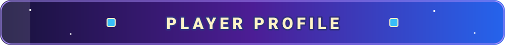
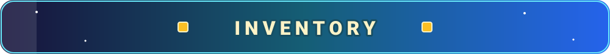
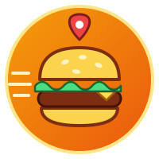
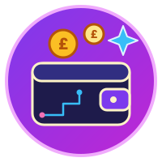
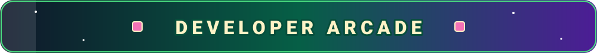
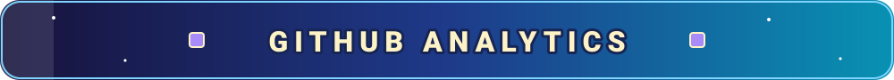
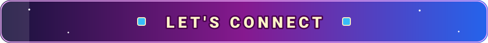

<!-- ═══════════════════════════════════════════════════════════
     YOUSSEF YASSER — GITHUB PROFILE README (v3)
     Assets in /assets:
       hero.svg, cta-portfolio.svg, divider.svg, terminal.svg, footer.svg,
       sec-profile / sec-inventory / sec-quests / sec-arcade / sec-analytics / sec-connect .svg,
       quest-edu.svg, quest-food.svg, quest-wallet.svg
     ═══════════════════════════════════════════════════════════ -->

<div align="center">

<!-- ══════════════ HERO ══════════════ -->


<br/><br/>

<!-- ══════════════ PRIMARY PORTFOLIO CTA (TOP) ══════════════ -->
<a href="https://portfolio-snowy-five-98.vercel.app/">
  
</a>

<br/>

<a href="https://portfolio-snowy-five-98.vercel.app/">
  <sub><strong>🌐 portfolio-snowy-five-98.vercel.app ↗</strong></sub>
</a>

<br/><br/>

<a href="https://github.com/Youssefsea">
  
</a>
<a href="https://www.linkedin.com/in/youssef-yasser-97aa742b0">
  
</a>


<br/><br/>


<br/>


<!-- ══════════════ PLAYER PROFILE ══════════════ -->


</div>

<table>
<tr>
<td width="58%" valign="top">

### 👋 Hey, I'm Youssef!

I'm a **Computer Science student and Full Stack Developer** who loves turning ideas into complete, working applications.

I enjoy both sides of the stack: building interfaces people actually like using, and engineering the backend systems that power them.

> 💡 **My philosophy:** build useful things, write better code, keep learning.

</td>
<td width="42%" valign="top">

- 🎨 **Frontend** — clean, interactive UX
- ⚙️ **Backend** — APIs and solid architecture
- 🗄️ **Databases** — modeling, caching, queries
- 🤖 **AI** — exploring AI-powered apps
- 🚀 **Shipping** — ideas into working products

</td>
</tr>
</table>

<div align="center">


<br/><br/>

<!-- ══════════════ INVENTORY ══════════════ -->


<br/><br/>

<table>
<tr>
<td align="center" width="24%"></td>
<td align="center"></td>
</tr>
<tr>
<td align="center"></td>
<td align="center"></td>
</tr>
<tr>
<td align="center"></td>
<td align="center"></td>
</tr>
<tr>
<td align="center"></td>
<td align="center"></td>
</tr>
<tr>
<td align="center"></td>
<td align="center"></td>
</tr>
<tr>
<td align="center"></td>
<td align="center">


</td>
</tr>
</table>

<br/>


<!-- ══════════════ FEATURED QUESTS ══════════════ -->


<br/>

<sub>Real features. Real workflows. Built to solve real problems.</sub>

</div>

<br/>

<!-- ─────────── QUEST 01: ذاكر صح ─────────── -->
<table width="100%">
<tr>
<td colspan="2">

</td>
</tr>
<tr>
<td width="70%" valign="top">

### 📚 ذاكر صح

A learning platform connecting **students, tutors, and learning centers** in one system.

- 🔐 Authentication and role management
- ⚙️ REST APIs and business logic
- 🗄️ PostgreSQL and Redis integration
- 🌍 Arabic right-to-left support


</td>
<td width="30%" align="center" valign="middle">


<br/>

<a href="https://center-saas-front-83p8.vercel.app/">
  
</a>

</td>
</tr>
</table>

<br/>

<!-- ─────────── QUEST 02: أكلي ─────────── -->
<table width="100%">
<tr>
<td colspan="2">

</td>
</tr>
<tr>
<td width="70%" valign="top">

### 🍔 أكلي

A complete food-delivery workflow connecting **customers, restaurants, orders, and location data**.

- 🔐 JWT authentication with HTTP-only cookies
- 🔌 30+ REST APIs
- ⚡ Real-time updates with Socket.IO
- 📍 Geospatial queries and location features


</td>
<td width="30%" align="center" valign="middle">



<br/>

<a href="https://food-front-rho.vercel.app/">
  
</a>

</td>
</tr>
</table>

<br/>

<!-- ─────────── QUEST 03: WealthWise AI ─────────── -->
<table width="100%">
<tr>
<td colspan="2">

</td>
</tr>
<tr>
<td width="70%" valign="top">

### 💰 WealthWise AI

A smart financial application that helps users interact with their financial data using **natural language and AI**.

- 💬 Natural-language expense input
- 🤖 AI-powered data extraction
- 🧾 Structured financial records
- 👛 Wallet data management

```text
"300 جنيه فراخ و150 جنيه عصير"  →  🤖 AI  →  STRUCTURED DATA  →  💰 WALLET
```


</td>
<td width="30%" align="center" valign="middle">



<br/>

<a href="https://wallet-wep-react.vercel.app/">
  
</a>

</td>
</tr>
</table>

<div align="center">

<br/>


<!-- ══════════════ DEVELOPER ARCADE ══════════════ -->


</div>

<br/>

<table>
<tr>
<td width="58%" align="center" valign="middle">

### 🐍 Contribution Snake

<!-- Needs the snake GitHub Action (.github/workflows/snake.yml). -->


</td>
<td width="42%" align="center" valign="middle">

### 🏆 Achievements


<br/>

<br/>

<br/>


</td>
</tr>
</table>

<table>
<tr>
<td width="46%" valign="top">

### 🎯 Current Mission

- Full Stack Development
- Better System Design
- Scalable API Architecture
- Database Engineering
- AI Integration
- Production Deployment

</td>
<td width="54%" align="center" valign="middle">



</td>
</tr>
</table>

<div align="center">


<!-- ══════════════ GITHUB ANALYTICS ══════════════ -->


<br/><br/>


<br/><br/>


<br/><br/>


<!-- ══════════════ CONNECT ══════════════ -->


<br/>

<p>Have an interesting idea or project? Let's build something awesome together.</p>

<!-- ══════════════ PRIMARY PORTFOLIO CTA (BOTTOM) ══════════════ -->
<a href="https://portfolio-snowy-five-98.vercel.app/">
  
</a>

<br/>

<a href="https://portfolio-snowy-five-98.vercel.app/">
  <sub><strong>🌐 portfolio-snowy-five-98.vercel.app ↗</strong></sub>
</a>

<br/><br/>

<a href="https://github.com/Youssefsea">
  
</a>
<a href="https://www.linkedin.com/in/youssef-yasser-97aa742b0">
  
</a>

<br/><br/>

<!-- ══════════════ FOOTER ══════════════ -->


</div>